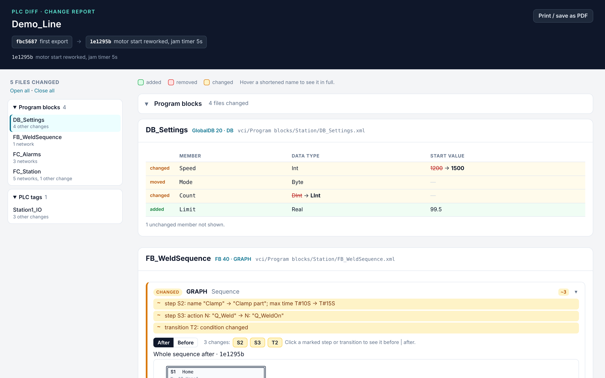
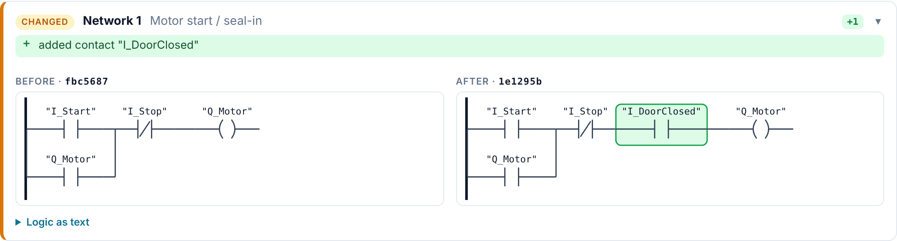
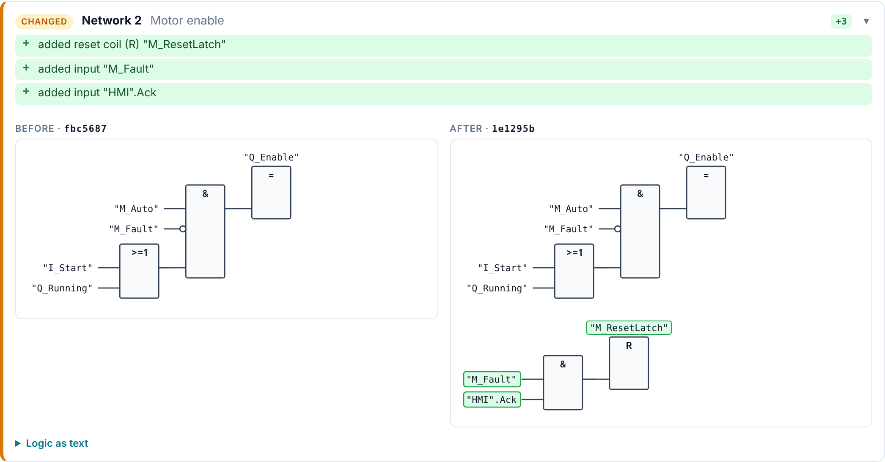
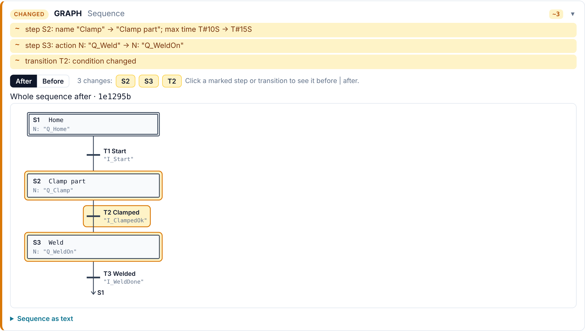
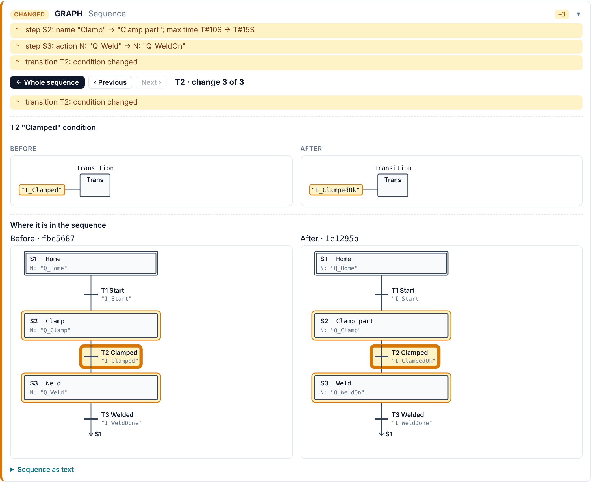
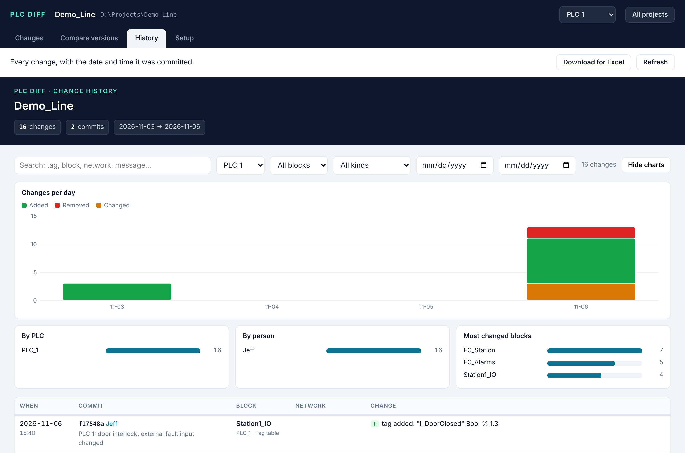

# PLC Diff

**See what changed in your Siemens TIA Portal PLC program — drawn as ladder, FBD and S7-GRAPH, not as XML.**

PLC Diff compares two versions of a TIA Portal V20 program and shows every changed network as a picture, before
and after side by side, with added parts in green, removed in red and changed in yellow. Versions come from Git:
TIA Portal's *Version Control Interface* exports your blocks as files into a Git repository, and PLC Diff reads them.

It runs on your own PC, opens in your browser, and needs nothing but Python and Git. Your code never leaves your PC
(GitHub is optional — a shared network folder works too).



| Ladder (LAD), before and after | Function block diagram (FBD), before and after |
| --- | --- |
|  |  |

| S7-GRAPH: the whole sequence first… | …click a change to see it before and after |
| --- | --- |
|  |  |

## What it does

### Compare versions

- **Any two versions** — two commits, or your fresh export against the last commit.
- **Drawn like in TIA** — LAD as ladder, FBD as FBD, SCL/STL as a text diff. Before and after are side by side;
  tag names are always shown in full.
- **S7-GRAPH sequences** — steps, transitions, branches, jumps, supervisions and interlocks. You first see the whole
  sequence with the changes marked; click a step or transition to see that change before and after, with its
  condition drawn as FBD and where it sits in the chain.
- **Data blocks and data types** — a before/after table: data type, start value, added, removed and moved members.
- **Easy to find your way** — changed files are grouped like TIA's project tree (Program blocks, PLC tags, PLC data
  types…) and listed in a sidebar. Big drawings start zoomed out with the changes highlighted; click a change to
  zoom in there. A block with many changed networks gets a toolbar: go to a network, show only one kind of change,
  find a tag, fold networks away.
- **No false alarms** — a block TIA only renumbered after a compile says "no logic change".
- **Compare two folders** — no Git needed: e.g. the customer's export against yours, or a backup from site.

### Look up and look back

- **Blocks tab** — every block of any version, grouped like TIA's project tree. Click one to see it drawn, even if it
  never changed; **History** lists every commit that changed it, with what changed.
- **Where is this tag used?** — type a tag in the Blocks tab: every network, data block and tag table that uses it,
  drawn, with the tag highlighted.
- **Change history** — every change with date, time and author, searchable, with charts, and a download for Excel.
- **Get an old version back** — put any earlier version of a single block into the TIA workspace folder, ready for
  *Import from workspace* in TIA (Setup → **Get an old version of a block back**).

### Work as a team

- **Commit and share** — one button to save ("commit") and send ("push") your changes, with a suggested message
  that lists what changed. Pull and conflicts (keep mine / use theirs) are handled for you.
- **Several PLCs, several people** — one folder per PLC in one project; each person commits only their own PLC.
- **Several projects** — a home screen with all your projects and their status.
- **Review sign-off** — mark a commit as reviewed, with a remark. It is shared with the team through Git and shows in
  the history, on the compare page and on the printed sign-off sheet.

### Safety, releases and reports

- **Safety** — F-blocks (F_LAD / F_FBD / F_DB) are marked, need an extra confirmation before committing, and can be
  reported on their own with a sign-off sheet.
- **Releases** — mark a version as a release (e.g. FAT, SAT) and attach the archive.
- **Reports** — print any comparison or save it as PDF.
- **Updates** — PLC Diff tells you when a new version is on GitHub and updates itself with one click
  (Setup → Updates to turn this off).



## Install (Windows)

1. Install **Git for Windows** — https://git-scm.com (default options are fine).
2. Install **Python 3.8 or newer** — https://python.org (tick *Add python.exe to PATH*).
3. Download the zip from the [latest release](https://github.com/sandro91145/plc-diff/releases/latest) and unzip
   it into a folder, e.g. `D:\Tools\PLCDiff` (or download `PLCDiff.pyw` and `Start PLC Diff.bat` into one folder).
4. Double-click **Start PLC Diff.bat**. The app opens in your browser.

No extra Python packages are needed. If the app can't find Git, paste the path to `git.exe` in **Setup**.

**Updating:** from version 1.4.0 on, PLC Diff offers new versions itself (**Update now**; your old file is kept as
`PLCDiff.pyw.bak`). Older versions: replace `PLCDiff.pyw` with the new one.

## Connect TIA Portal

1. In TIA Portal V20: *Version control interface* → add a workspace → point it to a folder inside your Git project,
   one folder per PLC, e.g. `<project>\vci\PLC_1`.
2. Drag the PLC's program blocks (and tag tables, data types) into the workspace and export.
3. In PLC Diff, open the project; under **Setup → PLCs** check that each PLC points to its folder.
4. After each change in TIA: export to the workspace, then in PLC Diff **Changes → Commit and share**.

## Command line (optional)

```
python PLCDiff.pyw --app                 # start the app
python PLCDiff.pyw HEAD~1 HEAD           # compare two commits, open the report
python PLCDiff.pyw --files old.xml new.xml
python PLCDiff.pyw --folders D:\Customer\Export D:\Projects\MyProject\vci\PLC_1
python PLCDiff.pyw --history --csv changes.csv   # history page + file for Excel
python PLCDiff.pyw --help
```

## Limits

- Reads TIA Portal V20 SimaticML exports. Hardware configuration, HMI and technology objects are not drawn.
- Tested on Windows; the code is plain Python and also runs on Linux/macOS (without TIA Portal, of course).

## For developers

Everything is in one file, `PLCDiff.pyw` (Python standard library only). `tests/make_samples.py` creates
realistic test exports (LAD, FBD, S7-GRAPH, a data block, a tag table) and `python tests/smoke.py` checks the whole
app with them in about 30 seconds. `CLAUDE.md` explains the structure, the TIA export formats and the design
decisions.

## License

MIT — see [LICENSE](LICENSE). Not affiliated with Siemens. *TIA Portal*, *SIMATIC* and *S7-GRAPH* are trademarks of
Siemens AG. Use at your own risk; always check changes in TIA Portal before downloading to a machine.
